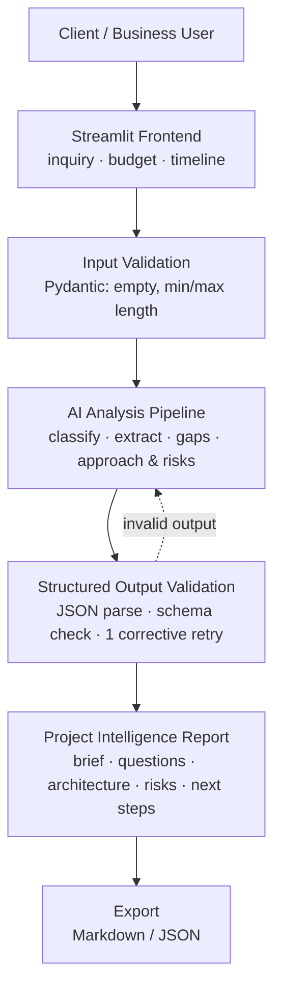

# 🧭 Cynbit AI Project Intelligence Copilot

**An LLM-powered assistant that turns a raw client inquiry into a structured, reviewable project brief.**


> **Note:** This is a proposed solution for AI automation and software consulting workflows. It is a portfolio project, not a description of any company's verified internal process. Output is a **draft for human review**, not a final scope, quote or commitment.

<!-- Add a screenshot or GIF here:  -->

---

## 📌 Problem

When a client sends an inquiry such as *"We need an AI assistant for our e-commerce website…"*, an analyst has to:

1. Work out what kind of project it is (AI/ML, SaaS, web, cloud, automation).
2. Separate what the client **stated** from what is **missing**.
3. Prepare clarifying questions, a first technical approach and a risk view.

This is slow, inconsistent between people, and happens before any real conversation with the client.

## ✅ Solution

Paste an inquiry, optionally add budget and timeline, and the Copilot produces a structured project brief that a human can review, edit and export.

### Features

| Capability | What you get |
|---|---|
| **Project classification** | AI/ML, SaaS, Web Development, Cloud, Automation, Other (multi-label) |
| **Information extraction** | Objectives, functional and non-functional requirements, constraints |
| **Gap analysis** | Missing information the client did not specify |
| **Clarifying questions** | Prioritised (High/Medium/Low) with *why it matters* |
| **Technical approach** | Suggested approach, components and data flow |
| **Risk analysis** | Risks with severity and mitigation |
| **Export** | Markdown and JSON, ready for review or CRM/ticket tools |

### Example

**Input**
> We need an AI assistant for our e-commerce website that answers customer questions and tracks orders.

**Output (abridged)**

| Field | Result |
|---|---|
| Category | AI chatbot and business automation |
| Requirements | Customer Q&A, order tracking, integration with existing systems |
| Suggested approach | LLM + RAG + order API integration |
| Missing details | E-commerce platform, order API availability, expected traffic |
| Next step | Gather requirements before finalizing the architecture |

---

## 🏗️ Architecture



### Key design decisions

- **Schema-first.** The Pydantic `ProjectBrief` model is the contract. Its JSON Schema is embedded in the prompt, and every response is validated against it.
- **Self-healing output.** If the model returns invalid JSON or breaks the schema, the validation error is fed back for one corrective retry before failing cleanly.
- **Single structured call for v1.** One reliable LLM call is easier to test and debug than a multi-agent setup. The four logical stages live in one prompt and can be split into separate steps (or moved to LangGraph) if evaluation shows it is needed.
- **Provider-agnostic.** One OpenAI-compatible client works with Gemini, OpenAI or a self-hosted model. Switching is three environment variables.
- **Prompt-injection awareness.** Client text is wrapped in `<inquiry>` tags and treated strictly as data.
- **No invented facts.** Anything the client did not state goes to *missing information*, not *requirements*. The model is told not to produce pricing or time estimates.
- **Human in the loop.** Output is labelled a draft, and includes a self-reported confidence level.

---

## 🧰 Tech Stack

| Component | Technology |
|---|---|
| Language | Python 3.10+ |
| UI | Streamlit |
| LLM | Gemini API (via OpenAI-compatible endpoint) or any OpenAI-compatible API |
| Prompting | Structured prompts with JSON output |
| Validation | Pydantic v2 |
| Testing | Pytest (offline, fake LLM client) |
| Config | python-dotenv |
| Deployment | Streamlit Community Cloud |

---

## 📁 Project Structure

```
Cynbit-AI-Project-Intelligence-Copilot/
├── app.py                    # Streamlit UI, results tabs, Markdown/JSON export
├── pipeline.py               # Validate input → call LLM → parse JSON → validate schema (+ retry)
├── prompts.py                # System and user prompt templates
├── schemas.py                # Pydantic models, input limits, Markdown renderer
├── tests/
│   ├── __init__.py
│   ├── sample_brief.py       # Sample input and expected brief fixture
│   ├── test_schemas.py       # Input validation and schema tests
│   └── test_pipeline.py      # Pipeline tests using a fake LLM client
├── AI_OPPORTUNITY_REPORT.md  # Opportunity analysis and comparison
├── TECHNICAL_APPROACH.md     # Architecture, pipeline and design decisions
├── requirements.txt          # Dependencies
├── pytest.ini                # Test configuration
├── .env.example              # API key / model configuration template
├── .gitignore                # Keeps .env and caches out of Git
└── README.md
```

---

## 🚀 Getting Started

### 1. Clone and install

```bash
git clone https://github.com/Suraj-Kumar09/Cynbit-AI-Project-Intelligence-Copilot.git
cd Cynbit-AI-Project-Intelligence-Copilot

python -m venv .venv
source .venv/bin/activate        # Windows: .venv\Scripts\activate
pip install -r requirements.txt
```

### 2. Configure the API key

```bash
cp .env.example .env
```

Edit `.env`:

```dotenv
LLM_API_KEY=your-api-key
LLM_BASE_URL=https://generativelanguage.googleapis.com/v1beta/openai/
LLM_MODEL=gemini-2.5-flash
```

For OpenAI, leave `LLM_BASE_URL` empty and set `LLM_MODEL=gpt-4o-mini`.

> 🔒 Never commit `.env`. It is already listed in `.gitignore`.

### 3. Run

```bash
streamlit run app.py
```

Open `http://localhost:8501`, pick a sample or paste an inquiry, and click **Analyze inquiry**.

### 4. Test

```bash
pytest
```

Tests run offline with a fake LLM client, so no API key or network is needed.

---

## 🧪 Testing Strategy

| Area | What is verified |
|---|---|
| Input validation | Empty, whitespace-only, too short and too long inputs are rejected |
| Schema | Valid briefs pass, unknown categories are rejected |
| Pipeline | Happy path, JSON wrapped in code fences, recovery after one bad reply, clean failure after retries |
| Safety | Invalid input never triggers an LLM call |
| Export | Markdown output contains the expected sections |

---

## 🛠️ Troubleshooting

| Symptom | Fix |
|---|---|
| `FileNotFoundError` from `ssl.create_default_context` | A stale `SSL_CERT_FILE` environment variable points to a missing file. The app removes broken CA variables at startup. You can also unset it manually. |
| `LLM_API_KEY is not set` | Create `.env` from `.env.example` and restart Streamlit. |
| `ScriptRunContext` warnings | Run with `streamlit run app.py`, not `python app.py`. |

---

## ⚠️ Limitations

- Output quality depends on the underlying model. The confidence level is self-reported, not calibrated.
- Avoid pasting confidential client data into a third-party API without approval.
- No persistence in v1. Briefs live in session state, so export to keep them.
- Not yet evaluated on a labelled set of real inquiries.

## 🗺️ Roadmap

- [ ] Evaluation set of 20–30 anonymised inquiries with reviewer scoring
- [ ] Multi-stage pipeline or LangGraph workflow, if evaluation justifies it
- [ ] Persistent history and CRM / Jira export
- [ ] Hinglish and Hindi inquiry support
- [ ] Streaming responses in the UI
- [ ] CI with GitHub Actions running `pytest`

---

## 👤 Author

**Suraj Kumar**
[LinkedIn](https://www.linkedin.com/in/aideveloperontop/) · [GitHub](https://github.com/Suraj-Kumar09/) · srsuraj009@gmail.com

## 📄 License

Released under the MIT License. Add a `LICENSE` file before publishing.
